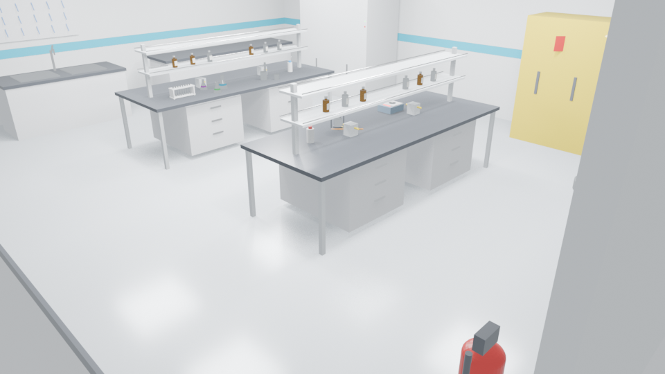

# Athanor Ascension

**Eine Offline-Simulation für Alchemie und Laborarbeit.** Echte Chemie, echte
Physik, kein Server im Ablauf. Du beginnst mit einer geliehenen Werkbank und
endest mit einem Netzwerk aus Laboren — legal, clandestin und orbital. Fehler
kosten Blut, Lungenkapazität oder Strahlendosis, keine Erfahrungspunkte.

[English](README.md) · [Español](README.es.md) · [日本語](README.ja.md)

> Stand: **spielbarer Vertical Slice**, kein fertiges Spiel. Der Chemie-Kern ist
> weit, die 3D-Welt früh. Die Tabelle unten ist die Wahrheit.


*Blender-Render des analytischen Laborsets (`chemlab.blend`), kein Runtime-Screenshot.*

## Was heute funktioniert

| System | Status | Anmerkung |
|---|---|---|
| Ladebildschirm | ✅ Live | Animiertes alchemistisches Sigill, prozeduraler Glasgeräte-Hintergrund |
| Hauptmenü | ✅ Live | Forschungsterminals, Grafik-, Eingabe- und Audiopresets |
| Labor-Netzwerk-Hub | ✅ Live | 15 reale Laborarchetypen, 14 Anzüge, Freischaltstufen |
| Genom-Archiv | ✅ Live | Zoombarer Karyotyp → Genort → Basenebene |
| Mutationssimulation | ✅ Live | Punktmutationen, Mutagen-Spektren, ehrliche VUS-Behandlung |
| Chromosomen-Dosis | ✅ Live | Trisomie-21-/Monosomie-X-Expressionsmodell |
| Beschleuniger-Terminal | ✅ Live | Relativistische Kinematik, Steifigkeit, Cherenkov, Aktivierung |
| Fusor-Werkstatt | ✅ Live | Aufbau-Checkliste, Paschen-Fenster, Neutronenausbeute, Dosis |
| Spieler-Vitalwerte | ✅ Live | HP, Verletzungen, ppm·min, mSv, Handlungsunfähigkeit |
| 3D-Analytikbank | 🟡 Teilweise | Begehbarer Raum; Interaktion wird noch verdrahtet |
| Aetherkin-Begleiter | 🟡 Daten live | 26 Arten definiert; Fähigkeiten im Runtime unvollständig |
| Chemie-Kern | ✅ Live | 256 Python-Tests, NIST/CRC-Konstanten, offline |
| Nintendo Switch | ⬜ Geplant | Ziel dokumentiert; SDK/NDA erforderlich |

Vollständiger Plan inklusive dessen, was **nicht** implementiert ist:
[docs/ROADMAP.md](docs/ROADMAP.md).

## Die vier spielbaren Terminals

### Genom-Archiv
Ein Karyotyp, zoombar vom ganzen Chromosom bis zur einzelnen Base. Kuratierte
Hotspots tragen echte HGVS- und Protein-Annotationen (HbS `p.Glu7Val`, CFTR
`p.Phe508del`, BRCA1 `c.5266dupC`, TP53 `p.Arg248Gln`). Alles außerhalb kuratierter
Hotspots wird ehrlich als **Variante unklarer Signifikanz (VUS)** gemeldet — der
Simulator erfindet keine Diagnose. Chemikalien nutzen reale Mutationsspektren:
EMS erzeugt GC→AT-Transitionen, UV C→T, Aflatoxin B1 GC→TA, Colchicin erzeugt
Non-Disjunction statt Substitutionen.


### Ignis-Beschleuniger
Teilchen und Energie wählen; das Terminal berechnet Lorentzfaktor, β, magnetische
Steifigkeit, benötigtes Dipolfeld, Umlaufrequenz, Strahlleistung, Cherenkov-Winkel
und Synchrotronverlust. Reaktionen haben echte Q-Werte und Schwellen (p+Li-7 ≈ 1,88
MeV, D–T exotherm). Target-Aktivität nach `A = N·σ·Φ·(1−e^(−λt))`.


### Fusor-Werkstatt
Kammer, Gitter, Durchführung, Pumpe, Deuteriumzufuhr, Ballastwiderstand und
Detektor aufbauen — jeder Schritt mit einem Satz "warum". Dann zünden: Paschen-
Durchbruch, mittlere freie Weglänge, empirische Neutronenausbeute, Fusionsleistung,
Q und Ortsdosisleistung. Fehlschläge tragen die Namen der realen Phänomene.


### Analytische 3D-Bank
Der begehbare Laborraum mit Abzug, Waage, Rührer, Bürette und Glasgeräten. Steuerung
heute per Tastatur/Maus; Webcam-Handtracking existiert im Python-Kern und ist nicht
Voraussetzung.

## Starten

```bash
tools/bin/godot --path game

tools/bin/godot --headless --path game --script res://scripts/smoke_test.gd
tools/bin/godot --headless --path game --script res://tests/test_genome_simulation.gd
tools/bin/godot --headless --path game --script res://tests/test_lab_physics.gd

.venv/Scripts/python.exe -m pytest
```

## Entwurfsregeln

- **Offline zuerst.** Keine Runtime-API-Keys, kein LLM nötig, um zu experimentieren.
- **Compatibility-Renderer.** Ziel Intel Iris Xe, 60 FPS.
- **Ehrliche Zahlen.** Reale Konstanten; empirische Modelle (Fusor-Ausbeute) sind
  in Code und UI als solche gekennzeichnet.
- **Reale Labore.** Containment nach WHO-BSL und ISO 14644.
- **KI nur zur Build-Zeit.** Nano Banana / Veo / Flow Music erzeugen Assets vor dem
  Release; das Spiel ruft sie nie auf. Prompts: [docs/ASSET_PROMPTS.md](docs/ASSET_PROMPTS.md).

## Lizenz

MIT für den Code. Drittanbieter-Assets behalten ihre Lizenzen; siehe
`docs/integrations/THIRD_PARTY_LICENSES.md`.
