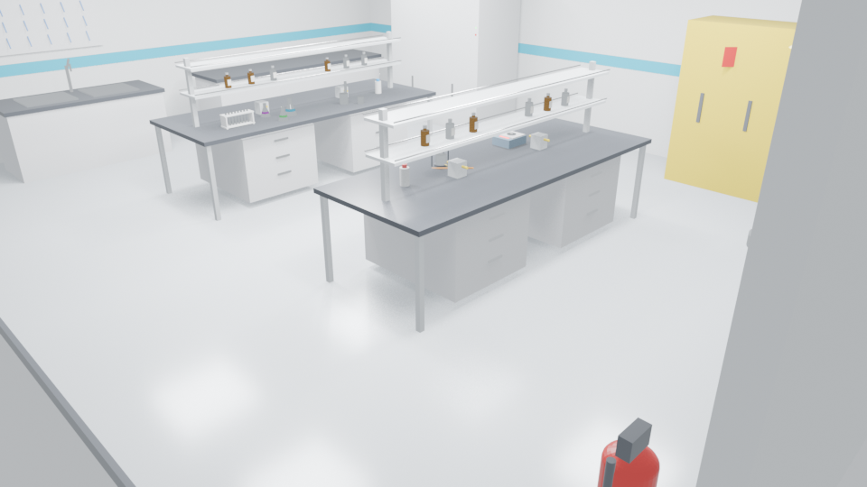

# Athanor Ascension

**Simulación de alquimia y laboratorio sin conexión.** Química y física reales,
sin servidor en el bucle. Empiezas con una mesa prestada y acabas gestionando una
red de laboratorios —legales, clandestinos y orbitales— mientras cada error cuesta
sangre, capacidad pulmonar o dosis de radiación en lugar de experiencia.

[English](README.md) · [Deutsch](README.de.md) · [日本語](README.ja.md)

> Estado: **vertical slice jugable**, no un juego terminado. El núcleo químico está
> maduro; el mundo 3D es temprano.


*Render de Blender del conjunto analítico, no una captura en ejecución.*

## Lo que funciona

| Sistema | Estado | Nota |
|---|---|---|
| Pantalla de carga | ✅ | Sigilo alquímico animado y fondo procedural de cristalería |
| Menú principal | ✅ | Terminales de investigación, ajustes de vídeo, entrada y audio |
| Hub de laboratorios | ✅ | 15 arquetipos reales, 14 trajes, niveles de desbloqueo |
| Archivo del genoma | ✅ | Cariotipo con zoom → locus → base |
| Simulación de mutaciones | ✅ | Mutaciones puntuales, espectros de mutágenos, VUS honestos |
| Dosis cromosómica | ✅ | Modelo de expresión para trisomía 21 / monosomía X |
| Terminal del acelerador | ✅ | Cinemática relativista, rigidez, Cherenkov, activación |
| Taller fusor | ✅ | Lista de montaje, ventana de Paschen, neutrones, dosis |
| Síntesis orgánica | ✅ | Protocolo de aspirina: estequiometría, reflujo, aislamiento, ensayo TLC/PF |
| Vitales del jugador | ✅ | Vida, lesiones, exposición ppm·min, dosis mSv |
| Banco analítico 3D | 🟡 | Sala transitable; interacción aún en curso |
| Compañeros Aetherkin | 🟡 | 26 especies definidas; habilidades incompletas |
| Núcleo químico | ✅ | 256 pruebas Python, constantes NIST/CRC, offline |
| Nintendo Switch | ⬜ | Objetivo documentado; requiere SDK bajo NDA |

Plan completo: [docs/ROADMAP.md](docs/ROADMAP.md).

## Los terminales jugables

### Archivo del genoma
Cariotipo navegable desde el cromosoma completo hasta una base. Los puntos
curados llevan anotaciones HGVS y proteicas reales (HbS `p.Glu7Val`, CFTR
`p.Phe508del`, BRCA1 `c.5266dupC`, TP53 `p.Arg248Gln`). Fuera de esos puntos el
simulador informa **variante de significado incierto (VUS)**; nunca inventa un
diagnóstico. Los mutágenos usan espectros reales: EMS GC→AT, UV C→T, aflatoxina
GC→TA, colchicina no-disjunción.


### Instalación de haces Ignis
Elige partícula y energía: factor de Lorentz, β, rigidez magnética, campo dipolar,
frecuencia de revolución, potencia del haz, ángulo de Cherenkov y pérdida
sincrotrón. Reacciones con valores Q y umbrales reales (p+Li-7 ≈ 1,88 MeV).
Actividad: `A = N·σ·Φ·(1−e^(−λt))`.


### Taller fusor
Monta cámara, rejilla, pasamuros, bomba, deuterio, resistencia de lastre y
detector, cada paso con su "por qué". Después enciende: ruptura de Paschen, camino
libre medio, rendimiento neutrónico empírico, potencia de fusión, Q y dosis.


### Banco analítico 3D
Sala transitable con campana, balanza, agitador, bureta y cristalería. Hoy se
controla con teclado y ratón; el seguimiento de manos existe en el núcleo Python y
no es obligatorio.

## Ejecutar

```bash
tools/bin/godot --path game
tools/bin/godot --headless --path game --script res://scripts/smoke_test.gd
tools/bin/godot --headless --path game --script res://tests/test_genome_simulation.gd
tools/bin/godot --headless --path game --script res://tests/test_lab_physics.gd
.venv/Scripts/python.exe -m pytest
```

## Reglas de diseño

- **Offline primero.** Sin claves en tiempo de ejecución ni LLM obligatorio.
- **Renderizador Compatibility** para Intel Iris Xe a 60 FPS.
- **Números honestos.** Constantes reales; los modelos empíricos están etiquetados.
- **Laboratorios reales.** Contención según BSL de la OMS e ISO 14644.
- **IA solo en producción.** Nano Banana / Veo / Flow Music generan assets antes del
  lanzamiento; el juego nunca los llama. Prompts: [docs/ASSET_PROMPTS.md](docs/ASSET_PROMPTS.md).

## Licencia

MIT para el código. Los assets de terceros conservan sus licencias.
