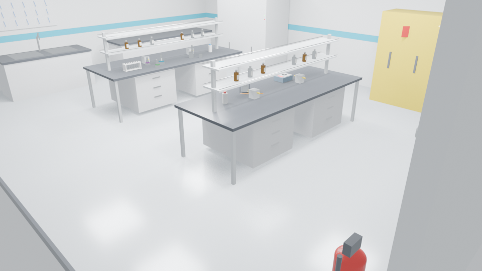

# Athanor Ascension

**オフラインで動く錬金術・実験室シミュレーション。** 本物の化学と物理。サーバー
もAPIキーも不要です。借り物の作業台から始め、合法・非合法・軌道上の実験室
ネットワークを築きます。失敗の代償は経験値ではなく、血、肺活量、被曝線量です。

[English](README.md) · [Deutsch](README.de.md) · [Español](README.es.md)

> 現状: **遊べるバーティカルスライス**であり、完成品ではありません。化学コアは
> 成熟していますが、3D世界はまだ初期段階です。


*Blenderによる分析実験室セットのレンダー（実行時キャプチャではありません）。*

## 現在動作するもの

| システム | 状態 | 備考 |
|---|---|---|
| ローディング画面 | ✅ | 錬金術のシジル、手続き生成のガラス器具背景 |
| メインメニュー | ✅ | 研究ターミナル、映像・入力・音声設定 |
| 実験室ネットワーク | ✅ | 実在の実験室15種、防護服14種、解放段階 |
| ゲノムアーカイブ | ✅ | 核型 → 遺伝子座 → 塩基レベルまでズーム |
| 突然変異シミュレーション | ✅ | 点突然変異、変異原スペクトル、VUSの正直な表示 |
| 染色体用量 | ✅ | 21トリソミー／Xモノソミーの発現モデル |
| 加速器ターミナル | ✅ | 相対論的運動学、磁気剛性、チェレンコフ、放射化 |
| フューザー工房 | ✅ | 組立チェックリスト、パッシェン領域、中性子収率、線量 |
| プレイヤー生体情報 | ✅ | HP、外傷、ppm·min曝露、mSv線量 |
| 3D分析ベンチ | 🟡 | 歩行可能。インタラクションは調整中 |
| Aetherkinの仲間 | 🟡 | 26種のデータ定義済み、実行時能力は未完成 |
| 化学コア | ✅ | Pythonテスト256件、NIST/CRC定数、オフライン |
| Nintendo Switch | ⬜ | 目標として文書化。SDKはNDA必須 |

全体計画: [docs/ROADMAP.md](docs/ROADMAP.md)

## 4つのターミナル

### ゲノムアーカイブ
染色体全体から1塩基までズームできる核型。キュレーション済みホットスポットには
実際のHGVS・タンパク質注記があります（HbS `p.Glu7Val`、CFTR `p.Phe508del`、
BRCA1 `c.5266dupC`、TP53 `p.Arg248Gln`）。ホットスポット外は**意義不明変異
（VUS）**として正直に表示し、診断を捏造しません。変異原も実スペクトルを使用:
EMSはGC→AT、UVはC→T、アフラトキシンB1はGC→TA、コルヒチンは染色体不分離。


### Ignisビーム施設
粒子とエネルギーを選ぶと、ローレンツ因子、β、磁気剛性、必要双極磁場、周回
周波数、ビーム出力、チェレンコフ角、シンクロトロン損失を計算。反応は実際のQ値
と閾値を持ちます（p+Li-7 ≈ 1.88 MeV）。放射化は `A = N·σ·Φ·(1−e^(−λt))`。


### フューザー工房
真空槽、グリッド、導入端子、ポンプ、重水素、バラスト抵抗、検出器を組み立て、
各項目に「なぜ」を表示。その後点灯: パッシェン破壊、平均自由行程、経験的中性子
収率、核融合出力、Q、作業位置の線量率。


### 3D分析ベンチ
ドラフト、天秤、スターラー、ビュレット、ガラス器具のある歩行可能な実験室。
現在はキーボードとマウスで操作。WebカメラのハンドトラッキングはPythonコアに
あり、必須ではありません。

## 実行

```bash
tools/bin/godot --path game
tools/bin/godot --headless --path game --script res://scripts/smoke_test.gd
tools/bin/godot --headless --path game --script res://tests/test_genome_simulation.gd
tools/bin/godot --headless --path game --script res://tests/test_lab_physics.gd
.venv/Scripts/python.exe -m pytest
```

## 設計原則

- **オフライン優先。** 実行時にAPIキーもLLMも不要。
- **Compatibilityレンダラー**でIntel Iris Xe 60 FPS。
- **正直な数値。** 実定数を使用し、経験モデルは明示。
- **実在の実験室。** WHO BSLとISO 14644に準拠。
- **AIは制作時のみ。** Nano Banana / Veo / Flow Musicは出荷前にアセットを生成し、
  ゲームはそれらを呼びません。プロンプト: [docs/ASSET_PROMPTS.md](docs/ASSET_PROMPTS.md)

## ライセンス

コードはMIT。第三者アセットは各ライセンスに従います。
