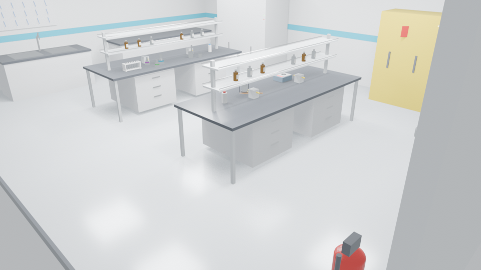
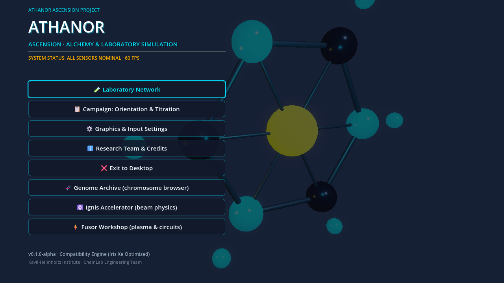

# Athanor Ascension

**An offline alchemy and laboratory simulation.** Real chemistry, real physics, no
server in the loop. You start as a nobody with a borrowed bench and end up running
a network of laboratories — legal, clandestine and orbital — while every mistake
costs blood, lung capacity or radiation dose rather than experience points.

[Deutsch](README.de.md) · [Español](README.es.md) · [日本語](README.ja.md)

> Current state: **playable vertical slice**, not a finished game. The chemistry
> core is mature; the 3D world is early. The status table below is the truth.


*Blender render of the analytical bench set (`chemlab.blend`), not a runtime capture.*

## What works today

| System | State | Notes |
|---|---|---|
| Loading window | ✅ Live | Animated alchemical sigil, procedural glassware backdrop |
| Main menu | ✅ Live | Research terminals, settings, input and audio presets |
| Laboratory Network hub | ✅ Live | 15 real lab archetypes, 14 suits, unlock tiers |
| Genome archive | ✅ Live | Zoomable karyotype → locus → base view, curated variants |
| Mutation simulation | ✅ Live | Point mutations, chemical mutagen spectra, VUS handling |
| Chromosome dosage | ✅ Live | Trisomy 21 / monosomy X expression model |
| Accelerator terminal | ✅ Live | Relativistic kinematics, rigidity, Cherenkov, activation |
| Fusor workshop | ✅ Live | Build checklist, Paschen window, neutron yield, dose |
| Player vitals | ✅ Live | HP, injuries, ppm·min exposure, mSv dose, incapacity |
| 3D analytical bench | 🟡 Partial | Walkable room and apparatus; interaction still being wired |
| Aetherkin companions | 🟡 Data live | 26 species defined; runtime abilities incomplete |
| Chemistry core | ✅ Live | 256 Python tests, NIST/CRC constants, offline |
| Nintendo Switch | ⬜ Planned | Target documented; SDK/NDA required |

Full plan, including what is explicitly **not** implemented: [docs/ROADMAP.md](docs/ROADMAP.md).


*Runtime capture of the actual menu: loading window, research terminals, tightened layout.*

## The four live terminals

### Genome archive
A karyotype you can zoom from whole chromosomes down to a single base. Curated
hotspots carry real HGVS and protein annotations (HbS `p.Glu7Val`, CFTR
`p.Phe508del`, BRCA1 `c.5266dupC`, TP53 `p.Arg248Gln`, …). Anything outside a
curated hotspot is reported honestly as a **variant of uncertain significance** —
the simulator never invents a diagnosis. Chemical mutagens use real mutation
spectra: EMS drives GC→AT transitions, UV drives C→T, aflatoxin B1 drives GC→TA,
colchicine causes nondisjunction rather than substitutions.

*Genome archive: karyotype map, locus track and phenotype report.*

### Ignis beam facility
Pick a particle and energy; the terminal computes the Lorentz factor, β, magnetic
rigidity, required dipole field, revolution frequency, beam power, Cherenkov angle
and synchrotron loss. Reactions have real Q values and thresholds (p+Li-7 ≈ 1.88
MeV, D–T exothermic). Target activity uses `A = N·σ·Φ·(1−e^(−λt))`.


### Fusor workshop
Build the vacuum chamber, grid, feedthrough, pump, deuterium supply, ballast
resistor and detector — each with a one-line "why". Then energise: Paschen
breakdown, mean free path, empirical neutron yield, fusion power, Q and operator
dose rate. Failures are named after real phenomena.


### Analytical bench (3D)
The walkable laboratory: benches, fume hood, balance, stirrer, burette, burner and
glassware. Controls are keyboard/mouse today; webcam hand tracking exists in the
Python core and is not required.

## Run it

Requirements: Godot 4.7.x (Compatibility renderer) for the game; Python 3.12 for
the chemistry core and tests.

```bash
# Game (windowed)
tools/bin/godot --path game

# Headless scene smoke test
tools/bin/godot --headless --path game --script res://scripts/smoke_test.gd

# Genome + lab physics tests
tools/bin/godot --headless --path game --script res://tests/test_genome_simulation.gd
tools/bin/godot --headless --path game --script res://tests/test_lab_physics.gd

# Python chemistry core
.venv/Scripts/python.exe -m pytest
```

## Design constraints

- **Offline first.** No runtime API keys, no LLM required to run an experiment.
- **Compatibility renderer.** Intel Iris Xe target, 60 FPS, ≤ 65 draw calls in the
  bench scene.
- **Honest numbers.** Real constants for thermodynamics and beam physics. Where a
  model is empirical (fusor neutron yield) it is labelled as such in code and UI.
- **Real labs.** Containment levels follow WHO BSL and ISO 14644 conventions.
- **Build-time AI only.** Nano Banana / Veo / Flow Music are used to produce assets
  before shipping; the game never calls them. Prompts: [docs/ASSET_PROMPTS.md](docs/ASSET_PROMPTS.md).

## Repository map

```
game/                 Godot project (scenes, scripts, data, ui)
  scenes/genomics/    interactive genome archive
  scenes/laboratories accelerator, fusor, lab hub, analytical bench
  scripts/labs/       offline physics models
  scripts/core/       player vitals
  data/labs/          lab + suit catalog
  data/genomics/      curated GRCh38 teaching dataset
  data/companions/    Aetherkin species database
src/chemlab/          Python chemistry, genomics, world, vision
chemlab_core/         legacy IPC core
tests/                Python test suite
docs/                 roadmap, asset prompts, architecture, audits
```

## License

MIT for the code. Third-party assets retain their own licenses; see
`docs/integrations/THIRD_PARTY_LICENSES.md`.
